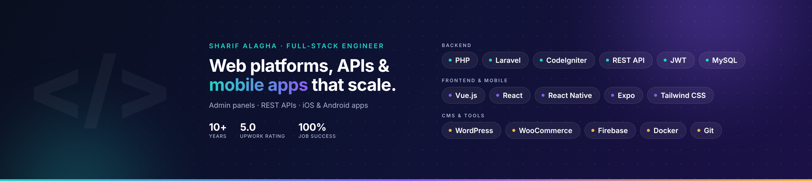

# Hi, I'm Sharif 👋

**Full-Stack Engineer** building web platforms, REST APIs and mobile apps with
Laravel · Vue.js · React Native · WordPress / WooCommerce

## About

I'm a full-stack engineer with **10+ years** of experience across government, education and freelance client work.
By day I'm a Web Engineer at the Ministry of Telecommunication and Information Technology (Gaza, Palestine);
I also freelance on Upwork with a **5.0 rating and 100% Job Success**.
Based in Khan Younis, Palestine · **open to remote work**.

## What I build

- 📱 **Mobile apps** (iOS & Android) with React Native and Expo
- ⚙️ **Backend APIs and admin panels** with Laravel / CodeIgniter, JWT authentication and third-party integrations
- 🛒 **Custom WordPress & WooCommerce** sites built from Figma, including Arabic / English (RTL) websites
- 🔎 **Search and performance work**, such as Arabic and English phonetic / fuzzy product search

## Selected projects

Most of my work is for clients and lives in private repositories, so each project has a write-up with the role, stack and screenshots:
**[→ Case studies](https://github.com/sharif-alagha/case-studies)**

<table>
  <tr>
    <td width="50%" valign="top">
      
      <b>Gasable</b>: REST API and admin panel for a gas-cylinder ordering app (team lead for the mobile developers) 
      PHP · CodeIgniter · MySQL · REST API · JWT
    </td>
    <td width="50%" valign="top">
      
      <b>Wholesale Wheel &amp; Tire</b>: iOS / Android ordering app with vehicle search and per-warehouse stock 
      React Native · Expo · Firebase · REST API
    </td>
  </tr>
  <tr>
    <td width="50%" valign="top">
      
      <b>Simple</b>: bilingual (EN / AR, RTL) UX studio website built from Figma as a custom WordPress theme 
      WordPress · ACF · PolyLang · MailPoet
    </td>
    <td width="50%" valign="top">
      <a href="https://github.com/sharif-alagha/case-studies/blob/main/outlet90-search.md">
        <b>Outlet90.com: Arabic &amp; English product search</b>
      </a> 
      Arabic normalization and phonetic matching, English fuzzy search, synonyms, brand recognition, relevance scoring, caching and analytics for a WooCommerce store. 
      WooCommerce · MySQL full-text · PHP
    </td>
  </tr>
</table>

## Tech stack

| | |
|---|---|
| **Backend** |      |
| **Frontend & Mobile** |      |
| **CMS & Tools** |      |

## Experience

- **Web Engineer**, Ministry of Telecommunication and Information Technology (2020 – present): government web applications with PHP / Laravel, Vue.js, Oracle and real-time notifications
- **Freelance Full-Stack Developer** (2015 – present): mobile apps, WordPress / WooCommerce and API projects for remote clients
- **Backend Developer & Team Lead**, Easy Solutions (2017 – 2019, part-time): REST API and admin panel for the Gasable app; led the mobile developers
- **Software Developer**, Palestine Technical College (2018 – 2019)
- **Web Developer**, University College of Science and Technology (2015 – 2017)

**Education:** MSc in Computer Engineering, Eastern Mediterranean University · BSc in Computer Engineering, Near East University

## Let's work together

Have a project in mind? Send me a short description and I'll reply with questions and an estimate.

[Hire me on Upwork](https://www.upwork.com/freelancers/~01817daea22b9ce0ec) · [Email](mailto:eng.alagha@gmail.com) · [LinkedIn](https://www.linkedin.com/in/sharif-alagha/)

<!--
OPTIONAL, add later when you publish open-source work:

## Open source
- [project-name](https://github.com/sharif-alagha/project-name): one-line description
-->
